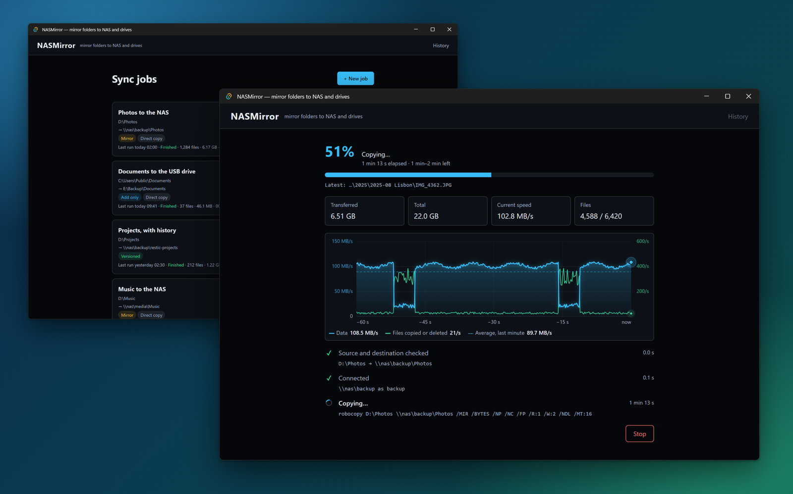
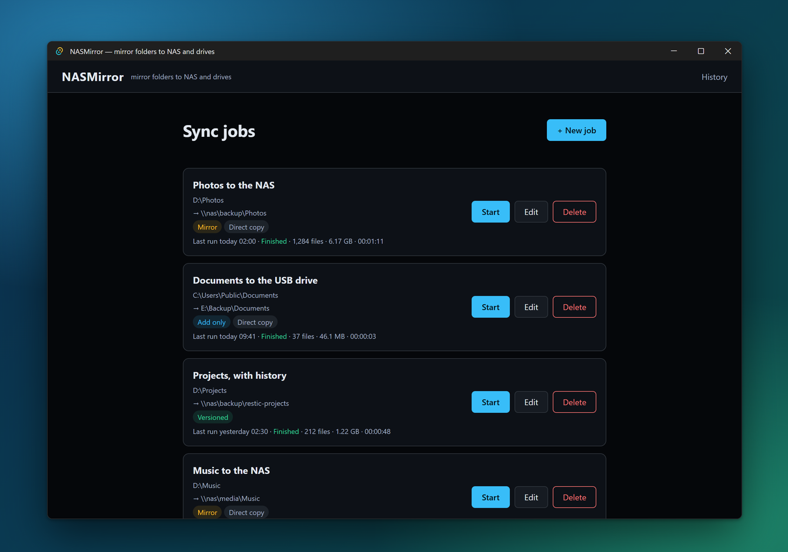
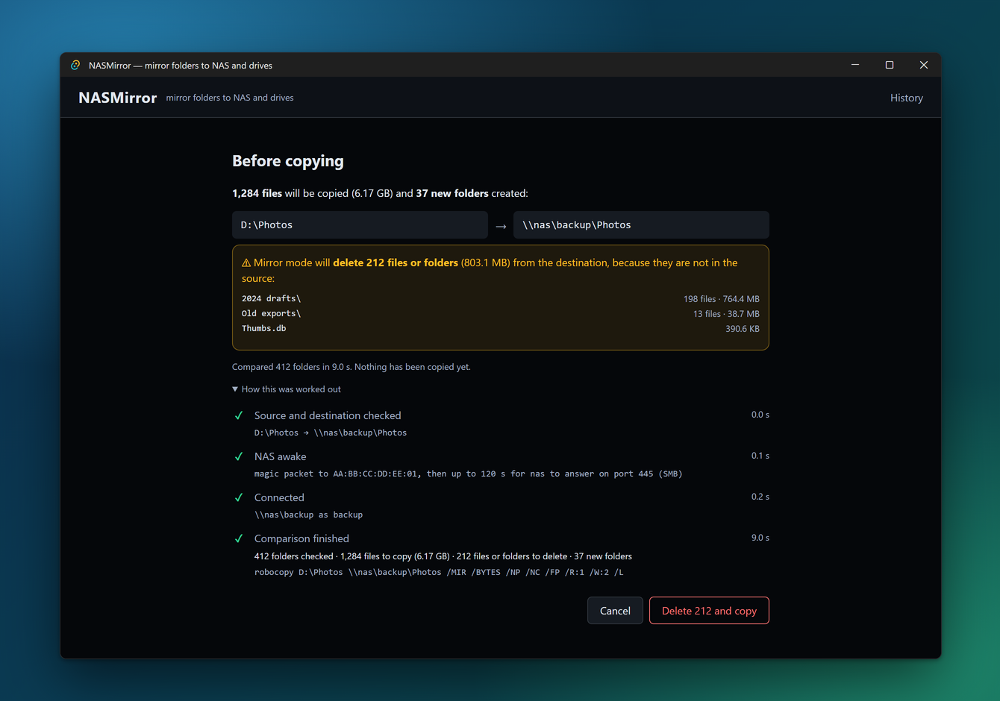
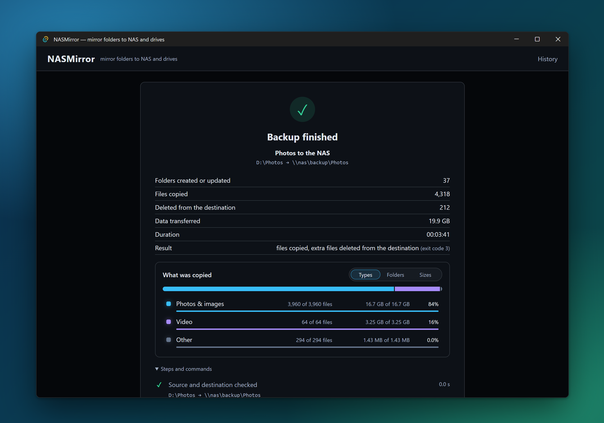
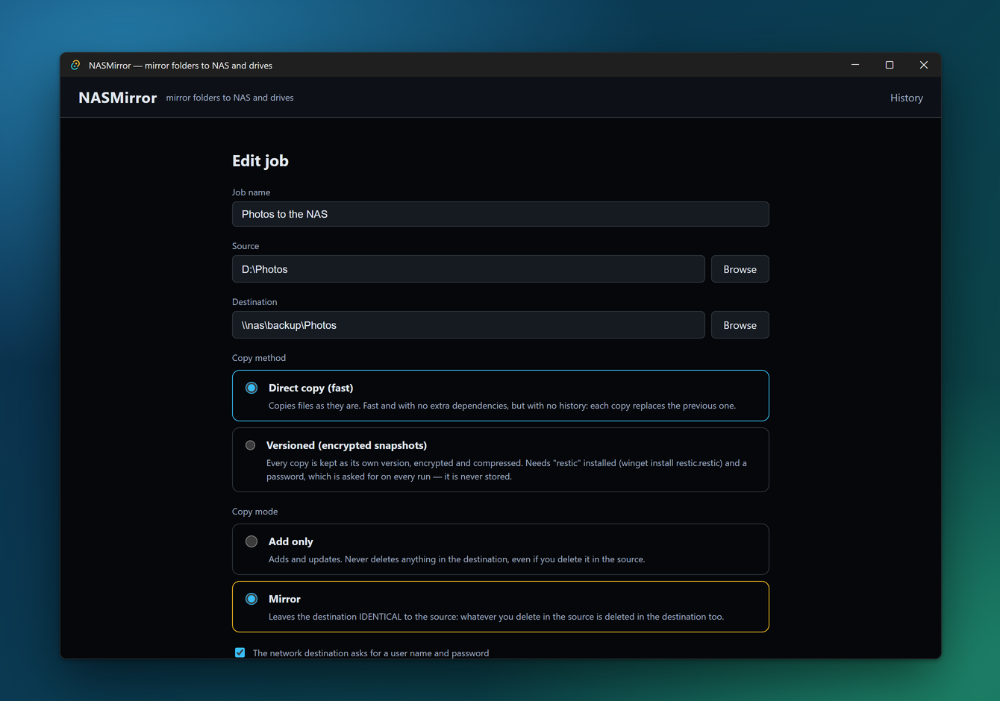
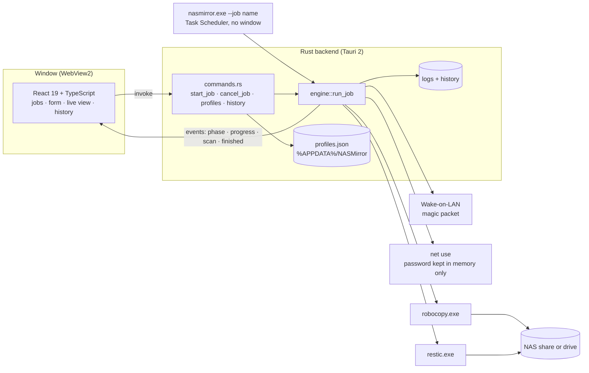
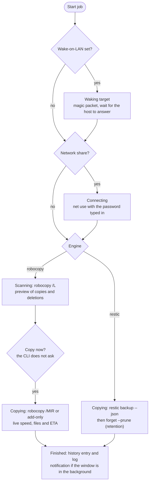

<p align="center">
  
</p>

<h1 align="center">NASMirror</h1>

<p align="center">
  <strong>Keep a copy of your folders on a NAS or an external drive, in one click.</strong><br>
  See what will change before anything happens, copy only what changed, and get
  it done faster than dragging the folder in File Explorer.
</p>

<p align="center">
  <a href="https://github.com/abarriuso/nasmirror/releases/latest"></a>
  <a href="https://github.com/abarriuso/nasmirror/actions/workflows/ci.yml"></a>
  
  <a href="LICENSE"></a>
</p>

<p align="center">
  <a href="https://github.com/abarriuso/nasmirror/releases/latest"><strong>Download for Windows</strong></a> ·
  <a href="#install">Install</a> ·
  <a href="#why-not-just-drag-the-folder-in-file-explorer">Why not File Explorer?</a> ·
  <a href="#benchmark">Benchmark</a> ·
  <a href="#usage">Usage</a>
</p>

> [!WARNING]
> **Work in progress.** NASMirror is under active development: features, the
> job format and the CLI may change between versions. Try it on non-critical
> data first, and keep an independent copy of anything you can't afford to
> lose, especially before using **mirror** mode, which deletes files from the
> destination.

## What it is

NASMirror is a free, open-source Windows app (MIT licence) for one everyday
task: keeping a copy of a folder (photos, documents, projects) on a NAS
(Synology, QNAP, TrueNAS, Unraid or any Windows network share) or on an
external drive.

You set up a job once, say *Photos to the NAS*. From then on, every time you
press **Start**, NASMirror:

1. wakes the NAS if it is asleep, and connects to the share;
2. compares the folder with the copy and shows what will be copied and, in
   mirror mode, deleted, **before touching anything**;
3. copies only new and changed files, several at a time, with live progress,
   speed and time left;
4. tells you how it went, and keeps the log of every run.

The copying is done by **robocopy**, the copy tool built into Windows that IT
departments have relied on for decades; NASMirror gives it a window, safety
checks and a history instead of a command line. For backups you can go back in
time with, a job can use **[restic](https://restic.net/)** instead: encrypted,
deduplicated, versioned snapshots.

It is for anyone who copies the same folders to a NAS or a drive every so
often and has watched File Explorer crawl through thousands of small files,
stop halfway on an error, or ask *Replace or skip?* about files that never
changed.

### Is this a backup?

Only with the **restic** engine. With **robocopy**, NASMirror *synchronises*:
the destination holds just the latest state of the source, with no history.
In mirror mode, anything deleted, corrupted or encrypted (by ransomware, say)
in the source is carried over to the destination on the next run. If you need
to go back in time, use restic, or keep a versioned backup alongside (NAS
snapshots, for instance).

## Why not just drag the folder in File Explorer?

Explorer is fine for a one-off copy of a few big files. For keeping a folder
in step with a NAS, this is what changes. The figures come from the
[benchmark](#benchmark) below.

| | File Explorer | NASMirror |
|---|---|---|
| **Thousands of small files** (documents, code) | 102 files/s | 739 files/s: **7× faster**, because it copies 16 files at a time |
| **Copying again** next week | Copies everything again (*Replace*), or skips every name that already exists, edited files included (*Skip*) | Copies only new and changed files |
| **Files you deleted** from the PC | Stay on the copy forever | Removed from the copy too (mirror mode), after you have seen the list; large deletions need an explicit yes |
| **A file open in another program** | The copy stops at that file and waits for you: 2,500 of 6,000 files copied in the test | Retries it once, skips it, copies the other 5,999 and says so at the end |
| **The network drops halfway** | Start again, and choose between *Replace* and *Skip* | Run the job again: it copies what is missing |
| **A sleeping NAS, a share that needs a login** | Up to you | Wake-on-LAN and the network login are part of the job |
| **What was copied, and when** | No record | A history of every run, with its full log |
| **Doing it regularly** | Remember to | Saved jobs, one click; or Windows Task Scheduler with `nasmirror --job` |

## Benchmark

NASMirror's copy (robocopy with exactly the options the app uses, its preview
comparison included) against the copy engine File Explorer uses when you drag
a folder, both copying the same test folders from a PC to a NAS.

| Test | File Explorer | NASMirror | |
|---|---|---|---|
| **6,000 small files**, 1–64 KB, 89 MB in all (documents, code) | 58.6 s (58.1–59.3)<br>102 files/s | 8.1 s (8.0–8.6)<br>739 files/s | **7.2× faster** |

**How it was measured**

- **Setup:** Windows 11 Pro, Ryzen 7 5700X3D, NVMe SSD, gigabit Ethernet,
  a home NAS over SMB. A different NAS or network gives different absolute
  numbers; the gap between the two tools is the point.
- **Test files:** generated random data (incompressible, like photos and
  video), so neither compression nor deduplication can help either tool.
- **Runs:** 3 per tool and test, alternating which tool goes first, into an
  empty folder every time. The table shows the median, and the fastest and
  slowest run in brackets. Both tools read the source from memory (every file
  was read once beforehand), so the PC's disk is not part of the result.
- **File Explorer** is Windows' shell copy engine (`SHFileOperation`), the one
  behind Explorer's copy and paste; driving it through Explorer's scripting
  interface (`Shell.Application.CopyHere`) took the same time.
- **NASMirror** is `robocopy <source> <destination> /MIR /BYTES /NP /NC /FP
  /R:1 /W:2 /NDL /MT:16`, timed together with the preview comparison
  (`robocopy … /L`) it runs first.
- **A file open in another program:** one of the 6,000 small files was held
  open, without sharing, by another process (copying to a local folder).
  Explorer's engine stopped there with a sharing violation; in the Explorer
  window you would see a dialog asking to try again, skip or cancel.
  NASMirror retried it once, two seconds later, skipped it and copied the
  rest (robocopy exit code 9: files copied, one failed).
- **A path longer than 260 characters:** both copied it (Windows 11 with long
  paths enabled), so it is not in the table.

The scripts are in [`docs/benchmark`](docs/benchmark), to repeat the test on
your own NAS.

## Screenshots

<table>
  <tr>
    <td width="50%"><br><b>Your jobs</b>, each with how its last run went.</td>
    <td width="50%"><br><b>Before copying</b>: what will be copied and deleted, and the exact commands behind it.</td>
  </tr>
  <tr>
    <td width="50%"><br><b>When it ends</b>: what was done, in plain words, with the log one click away.</td>
    <td width="50%"><br><b>A job</b>: source and destination, direct copy or versioned snapshots, add-only or mirror.</td>
  </tr>
</table>

The screenshots use made-up jobs and paths.

## Install

From PowerShell (no admin needed; installs for the current user and adds
`nasmirror.exe` to your PATH):

```powershell
irm https://raw.githubusercontent.com/abarriuso/nasmirror/main/install.ps1 | iex
```

Or download the installer (`.msi` or `-setup.exe`) from the
[Releases](https://github.com/abarriuso/nasmirror/releases) page. The
installers are not code-signed yet, so when you open one downloaded with a
browser, Windows SmartScreen may say *Windows protected your PC*: choose
**More info → Run anyway**.

To uninstall: **Settings → Apps → Installed apps → NASMirror**.

### Requirements

- Windows 10 or 11 (with WebView2, which ships with Windows 11).
- For restic: `winget install restic.restic`.
- For network destinations: a user with access to the share.

## Usage

1. Open **NASMirror**.
2. Press **+ New job** and set the source, the destination, the copy method
   (direct copy or versioned) and the mode (add only or mirror). Save it.
3. Press **Start** on the job card. If the job logs in to the network, type
   the password (it is never stored) and press **Preview**.
4. Check what will be copied and deleted, and press **Copy now** (in mirror
   mode, **Delete N and copy**).
5. When it ends, the results panel shows the summary and links to the log.
   Every run is also in **History**.

### Unattended mode

The same executable runs a saved job with no window (by name or id), which is
what Windows Task Scheduler needs:

```
nasmirror.exe --job "Photos to the NAS"
nasmirror.exe --job "Photos to the NAS" --dry-run   # scan only: copies and deletes nothing
```

Every real run shows up in the **History** screen with its result, including
one that fails before copying (an unplugged drive, a NAS that does not wake
up). Exit codes 3 and 5 below are refusals, not runs, and are not recorded.
To run a job every night at 02:00 as your user (jobs live in your
`%APPDATA%`, so the task has to run as you):

```powershell
$action  = New-ScheduledTaskAction -Execute "$env:LOCALAPPDATA\NASMirror\nasmirror.exe" `
           -Argument '--job "Photos to the NAS"'
$trigger = New-ScheduledTaskTrigger -Daily -At 2am
Register-ScheduledTask -TaskName 'NASMirror - Photos to the NAS' -Action $action -Trigger $trigger
```

If you installed the `.msi`, the program is in `$env:ProgramFiles\NASMirror`.

Task Scheduler waits for the job and shows its exit code as the task's
**Last Run Result**. A terminal does not: the installed build is a windowed
app, so PowerShell returns at once and prints nothing. To wait for the result
by hand:

```powershell
(Start-Process nasmirror.exe -ArgumentList '--job "Photos to the NAS"' -Wait -PassThru).ExitCode
```

| Code | Meaning                                                             |
|------|---------------------------------------------------------------------|
| 0    | Copy succeeded, or nothing to do                                    |
| 1    | The copy failed, it could not connect, the saved jobs could not be read, a mirror run refused deletions that need a yes in the window, or another NASMirror (the window or another task) was already running a job (in the last two, nothing was copied or deleted) |
| 2    | Cancelled                                                           |
| 3    | Job not found                                                       |
| 4    | Finished with warnings (robocopy: a name that is a file on one side and a folder on the other, not copied; restic: some files could not be read) |
| 5    | The job needs a password (network or restic) and cannot run headless |
| 6    | The arguments were not understood (a typo such as `--dryrun`, or `--job` with no name) |

## Features

- **Several named jobs** — create, edit and delete sync jobs. Each one
  remembers its source, destination, engine, mode, network credentials and
  advanced options.
- **Preview** (robocopy) — before copying, the app works out what needs doing
  and shows a summary (files to copy, new folders, data, deletions in mirror
  mode). While it compares, it shows the folders checked so far, the one it is
  in and what it has found; confirming the preview starts the copy without
  comparing again. Restic jobs go straight to the snapshot.
- **Every step in view** — checking the paths, waking the NAS, connecting to
  the share (and as whom), comparing, copying: each with its time and the
  exact command line it runs.
- **Live progress** — progress bar, transferred/total, speed, files, time
  left, and a live chart of data and files per second over the last minute.
- **Mirror and add-only modes** — mirror leaves the destination identical to
  the source (deleting whatever is left over); add-only only adds and updates,
  never deletes. Point a mirror at a folder of its own (`\\nas\copy\Photos`),
  never at the root of a drive or share. The preview lists what a mirror
  would delete, folder by folder. Deleting from a root, deleting 1,000 items
  or 1 GB or more, or deleting a folder named like the source needs an
  explicit yes, and an unattended run refuses it.
- **Wake-on-LAN** — if the NAS is off, it wakes it over the network first.
- **SMB credentials** — connects to network shares with a user name and
  password. The password is never written to disk.
- **Advanced options** — threads (`/MT`), unbuffered I/O (`/J`), retries, time
  tolerance (`/FFT`), folder and file exclusions.
- **Restic retention** — set how many daily, weekly and monthly versions to
  keep.
- **History** — every run is recorded with its date, result, files, data and
  duration; the full log of each run is one click away.
- **Finished notifications** — a system notification when a job ends and the
  window is not in the foreground.
- **Unattended mode (CLI)** — `nasmirror --job "name"` runs a saved job with no
  window and returns the real exit code, meant for Windows Task Scheduler.
  Jobs that need a password (SMB credentials or restic) cannot run headless
  yet.

## How it works

The window is a React app inside Tauri's WebView2; everything that touches the
disk, the network or another process runs in Rust. The same engine serves the
window and the unattended CLI.



What a job goes through, phase by phase:



### Built with

| Layer      | Technology                                     |
|------------|------------------------------------------------|
| Framework  | [Tauri 2](https://tauri.app/) (Rust + WebView)  |
| Frontend   | React 19 + TypeScript + Vite                    |
| Backend    | Rust (tokio, clap, windows-rs, chrono)          |
| Engines    | Robocopy (ships with Windows) / Restic          |

### Layout

| Path                         | What lives there                                  |
|------------------------------|---------------------------------------------------|
| `app/src/`                   | React frontend (components, API, types)           |
| `app/src-tauri/src/`         | Rust backend (commands, engine, profiles, history) |
| `app/src-tauri/src/engine/`  | Copy engines (robocopy, restic, netuse, wol)      |
| `docs/`                      | Screenshots and the benchmark scripts             |
| `%APPDATA%/NASMirror/`       | Jobs (`profiles.json`) and logs (`logs/`)         |

## Development

You need [Node.js](https://nodejs.org/) 22 (or 20.19+) and
[Rust](https://rustup.rs/) stable (with the
[Tauri prerequisites for Windows](https://tauri.app/start/prerequisites/)).

```bash
cd app
npm install
npm run tauri dev     # window with hot reload
npm run lint          # oxlint
npm test              # frontend tests (vitest)
npm run test:rust     # engine tests (cargo test)
npm run tauri build   # MSI + NSIS installers in src-tauri/target/release/bundle
```

### Publishing a version

1. Bump the version in `app/package.json`, `app/src-tauri/Cargo.toml` and
   `app/src-tauri/tauri.conf.json`, and write the changes down in
   `CHANGELOG.md`.
2. `git tag vX.Y.Z && git push origin vX.Y.Z`
3. The **Release** workflow builds the installers and creates a draft release
   on GitHub; review it and publish it.

## Security

- The network password and the restic repository password are **never stored**
  on disk. They are asked for on every run and live only in memory while the
  job runs.

## Roadmap

- Passwords from environment variables in the CLI, so restic and
  authenticated SMB jobs can run from Task Scheduler.
- Built-in scheduling instead of setting up Task Scheduler by hand.
- Restoring from restic snapshots inside the app (today: `restic restore`).
- Log rotation / a cap on the logs folder.
- Export and import of jobs.
- Auto-update from GitHub Releases.

## Licence

Released under the MIT licence. See the `LICENSE` file.
