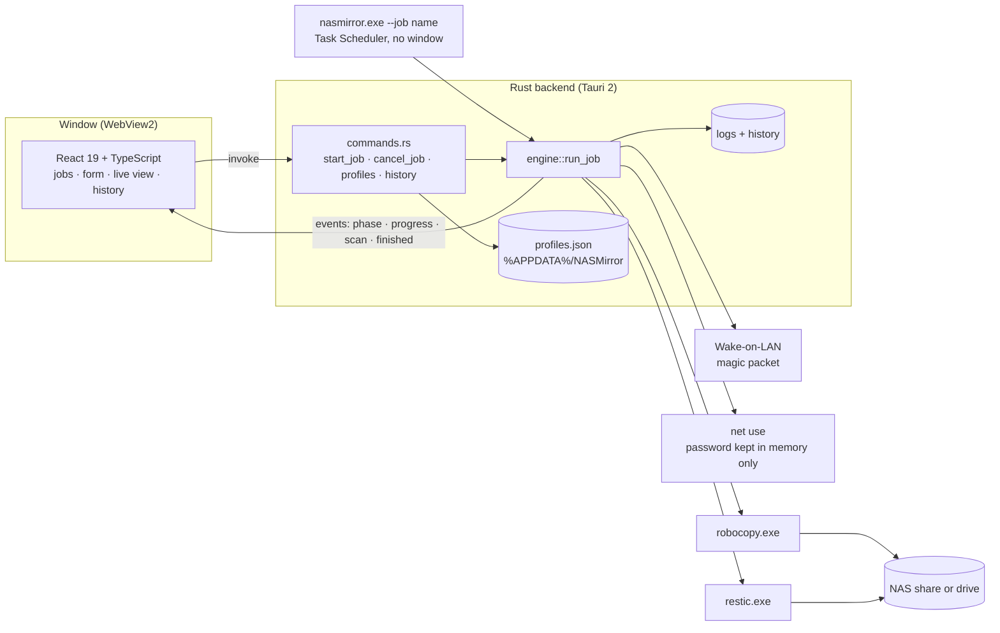
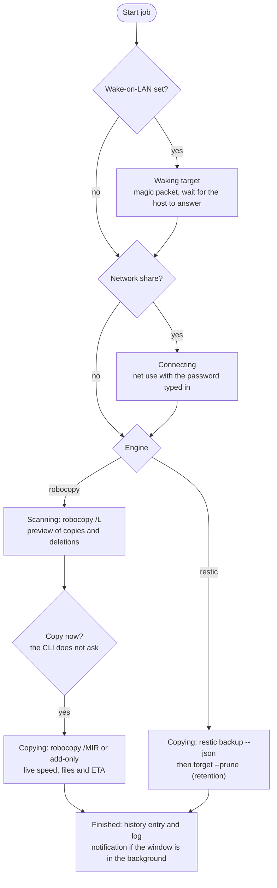

# NASMirror — mirror folders to NAS and drives

[](https://github.com/abarriuso/nasmirror/actions/workflows/ci.yml)

> [!WARNING]
> **Work in progress.** NASMirror is under active development: features, the
> profile format and the CLI may change between versions. Test it on
> non-critical data first, and keep an independent copy of anything you
> can't afford to lose — especially before using **mirror** mode, which
> deletes files from the destination.

A Windows desktop app that copies folders to drives or to a NAS over the
network (SMB), with a dark control-panel interface: progress bar, live stats
(transferred, speed, files, ETA) and a live speed chart.

Two engines, chosen per job:

- **Robocopy** — fast, no dependencies. Mirrors or adds files as they are.
- **Restic** — every run is kept as an encrypted, deduplicated snapshot.
  Needs [restic](https://restic.net/) installed (`winget install restic.restic`).

### Is this a backup?

Only with the **restic** engine. With **robocopy** NASMirror *synchronises*:
the destination holds just the latest state of the source, with no history.
In mirror mode, anything deleted, corrupted or encrypted (e.g. by ransomware)
in the source is propagated to the destination on the next run. If you need
to go back in time, use restic, or keep a versioned backup alongside
(NAS snapshots, for instance).

## Features

- **Several named jobs** — create, edit and delete sync jobs. Each one
  remembers its source, destination, engine, mode, network credentials and
  advanced options.
- **Preview** (robocopy) — before copying, the app works out what needs doing
  and shows a summary (files to copy, new folders, data, deletions in mirror
  mode). While it compares, it shows the folders checked so far, the one it is
  in and what it has found; confirming the preview starts the copy without
  comparing again. Restic jobs go straight to the snapshot.
- **Every step in view** — checking the paths, waking the NAS, connecting to
  the share (and as whom), comparing, copying: each with its time and the
  exact command line it runs.
- **Live progress** — progress bar, transferred/total, speed (10 s / 60 s
  averages), files, ETA and a speed chart interpolated to the monitor's real
  refresh rate.
- **Mirror and add-only modes** — mirror leaves the destination identical to
  the source (deleting whatever is left over); add-only only adds and updates,
  never deletes. Point a mirror at a folder of its own (`\\nas\copy\COSAS`),
  never at the root of a drive or share. The preview lists what a mirror
  would delete, folder by folder. Deleting from a root, deleting 1,000 items
  or 1 GB or more, or deleting a folder named like the source needs an
  explicit yes, and an unattended run refuses it.
- **Wake-on-LAN** — if the NAS is off, it wakes it over the network first.
- **SMB credentials** — connects to network shares with a user name and
  password. The password is never written to disk.
- **Advanced options** — threads (`/MT`), unbuffered I/O (`/J`), retries, time
  tolerance (`/FFT`), folder and file exclusions.
- **Restic retention** — set how many daily, weekly and monthly versions to
  keep.
- **History** — every run is recorded with its date, result, files, data and
  duration; the full log of each run is one click away.
- **Finished notifications** — a system notification when a job ends and the
  window is not in the foreground.
- **Unattended mode (CLI)** — `nasmirror --job "name"` runs a saved job with no
  window and returns the real exit code, meant for Windows Task Scheduler.
  Jobs that need a password (SMB credentials or restic) cannot run headless
  yet.

## Interface

- **Job list** — the main screen, with every saved job and its last run (when,
  how it ended, files and data). One click to start, edit or delete.
- **Job form** — source and destination (with Browse), engine, mode,
  credentials, WoL and advanced options; it says what is missing before
  saving.
- **Live copy view** — percentage, progress bar, stats, elapsed time, latest
  file, speed chart and the steps so far.
- **Results panel** — when it ends: files copied, data transferred, duration,
  exit code (robocopy) or snapshot (restic), the steps with their commands,
  and the run's log.
- **History** — earlier runs with their result and the full log of each one.

## Usage

1. Open **NASMirror**.
2. Press **+ New job** and set the source, destination, engine and mode.
3. Save it and press **Start** on the job card.
4. Check the preview and press **Copy now**.
5. When it ends, the results panel shows the summary and links to the log.

### Unattended mode

The same executable runs a saved job with no window (by name or id), which is
what Windows Task Scheduler needs:

```
nasmirror.exe --job "Photos to the NAS"
nasmirror.exe --job "Photos to the NAS" --dry-run   # scan only: copies and deletes nothing
```

Every real run shows up in the **History** screen with its result, including
one that fails before copying (an unplugged drive, a NAS that does not wake
up). Exit codes 3 and 5 below are refusals, not runs, and are not recorded.
To run a
job every night at 02:00 as your user (jobs live in your `%APPDATA%`, so the
task has to run as you):

```powershell
$action  = New-ScheduledTaskAction -Execute "$env:LOCALAPPDATA\NASMirror\nasmirror.exe" `
           -Argument '--job "Photos to the NAS"'
$trigger = New-ScheduledTaskTrigger -Daily -At 2am
Register-ScheduledTask -TaskName 'NASMirror - Photos to the NAS' -Action $action -Trigger $trigger
```

If you installed the `.msi`, the program is in `$env:ProgramFiles\NASMirror`.

Task Scheduler waits for the job and shows its exit code as the task's
**Last Run Result**. A terminal does not: the installed build is a windowed
app, so PowerShell returns at once and prints nothing. To wait for the result
by hand:

```powershell
(Start-Process nasmirror.exe -ArgumentList '--job "Photos to the NAS"' -Wait -PassThru).ExitCode
```

| Code | Meaning                                                             |
|------|---------------------------------------------------------------------|
| 0    | Copy succeeded, or nothing to do                                    |
| 1    | The copy failed, it could not connect, the saved jobs could not be read, or a mirror run refused deletions that need a yes in the window (nothing was copied or deleted) |
| 2    | Cancelled                                                           |
| 3    | Job not found                                                       |
| 4    | Finished with warnings (robocopy: attribute differences; restic: some files could not be read) |
| 5    | The job needs a password (network or restic) and cannot run headless |

## Built with

| Layer      | Technology                                     |
|------------|------------------------------------------------|
| Framework  | [Tauri 2](https://tauri.app/) (Rust + WebView)  |
| Frontend   | React 19 + TypeScript + Vite                    |
| Backend    | Rust (tokio, clap, windows-rs, chrono)          |
| Engines    | Robocopy (ships with Windows) / Restic          |

## How it works

The window is a React app inside Tauri's WebView2; everything that touches the
disk, the network or another process runs in Rust. The same engine serves the
window and the unattended CLI.



What a job goes through, phase by phase:



## Layout

| Path                         | What lives there                                  |
|------------------------------|---------------------------------------------------|
| `app/src/`                   | React frontend (components, API, types)           |
| `app/src-tauri/src/`         | Rust backend (commands, engine, profiles, history) |
| `app/src-tauri/src/engine/`  | Copy engines (robocopy, restic, netuse, wol)      |
| `%APPDATA%/NASMirror/`       | Jobs (`profiles.json`) and logs (`logs/`)         |

## Install

From PowerShell (no admin needed; installs for the current user and adds
`nasmirror.exe` to your PATH):

```powershell
irm https://raw.githubusercontent.com/abarriuso/nasmirror/main/install.ps1 | iex
```

Or download the installer (`.msi` or `-setup.exe`) from the
[Releases](https://github.com/abarriuso/nasmirror/releases) page.

### Updates

On start, NASMirror asks GitHub whether a newer version has been published.
If so, it offers to install it, but only from the job list with no copy
running; on **Update** it downloads the installer, checks its signature,
installs it (the `-setup.exe` for the PowerShell install, the `.msi` for an
MSI install, which asks for admin rights) and opens again. A check that
fails (offline, no published release yet) is silent: the app simply starts
as usual.

**0.9.0 cannot update itself**: it was built before the updater. Install the
next version once by hand (run the PowerShell line above again, or download
the installer); from then on updates arrive on their own.

## Requirements

- Windows 10 or 11 (with WebView2, which ships with Windows 11).
- For restic: `winget install restic.restic`.
- For network destinations: a user with access to the share.

## Development

You need [Node.js](https://nodejs.org/) 22 (or 20.19+) and
[Rust](https://rustup.rs/) stable (with the
[Tauri prerequisites for Windows](https://tauri.app/start/prerequisites/)).

```bash
cd app
npm install
npm run tauri dev     # window with hot reload
npm run lint          # oxlint
npm test              # frontend tests (vitest)
npm run test:rust     # engine tests (cargo test)
npm run tauri:unsigned  # MSI + NSIS installers in src-tauri/target/release/bundle
```

`npm run tauri:unsigned` builds the installers without the update signatures,
so it needs no signing key; `npm run tauri build` signs them, and needs the
key (see below).

### Publishing a version

1. Bump the version in `app/package.json`, `app/src-tauri/Cargo.toml` and
   `app/src-tauri/tauri.conf.json`, and write the changes down in
   `CHANGELOG.md`. Commit and push that before tagging: the release is built
   from the tagged commit, and one still numbered as the installed version is
   not offered as an update.
2. `git tag vX.Y.Z && git push origin vX.Y.Z`
3. The **Release** workflow builds the installers, signs them, and creates a
   draft release on GitHub with the installers, their `.sig` signatures and
   `latest.json`; review it and publish it.

Installed copies read
`https://github.com/abarriuso/nasmirror/releases/latest/download/latest.json`,
which only points at the latest **published**, non-prerelease release: a
draft is invisible to them until you publish it, and a prerelease never
reaches them.

Signing needs a key pair, created once:

1. `npm run tauri signer generate -- -w ~/.tauri/nasmirror.key` (from `app/`),
   with a password. Keep the private key and its password safe and out of the
   repository: without them no update can be published that existing installs
   accept.
2. Paste the contents of `~/.tauri/nasmirror.key.pub` into `plugins.updater.pubkey`
   in `app/src-tauri/tauri.conf.json`.
3. In the repository's **Settings → Secrets and variables → Actions**, add
   `TAURI_SIGNING_PRIVATE_KEY` (the contents of `~/.tauri/nasmirror.key`) and
   `TAURI_SIGNING_PRIVATE_KEY_PASSWORD`.

The **Release** workflow refuses to build while `pubkey` still holds the
placeholder: copies installed from such a release could never update. A
copy built with `npm run tauri:unsigned` before the key was pasted has the
placeholder too, and needs the next version installed by hand.

`npm run tauri build` needs both variables set locally, since it signs the
installers.

## Security

- The network password and the restic repository password are **never stored**
  on disk. They are asked for on every run and live only in memory while the
  job runs.

## Roadmap

- Passwords from environment variables in the CLI, so restic and
  authenticated SMB jobs can run from Task Scheduler.
- Built-in scheduling instead of setting up Task Scheduler by hand.
- Restoring from restic snapshots inside the app (today: `restic restore`).
- Log rotation / a cap on the logs folder.
- Export and import of jobs.

## Licence

Released under the MIT licence. See the `LICENSE` file.
